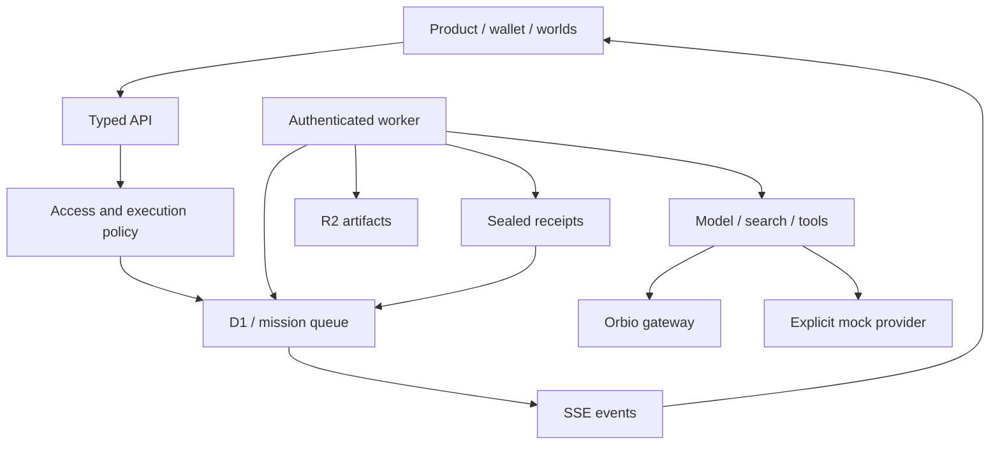

# Architecture

The deployed application is an App Router product running through Vinext on a Cloudflare Worker. Standard Next.js is also a verified build/dev target. Platform access is isolated by `lib/platform.ts`; the Node target replaces it with `platform-node.ts`. Production data is D1 (managed SQLite), with R2 for artifacts. Fifteen schema entities are defined in `db/schema.ts` and migrated in `drizzle/`.

The database stores wallets/users, hashed sessions, authentication challenges, missions, CONTROL allocations, mission support, events, receipts, worlds, artifacts, reputation signals, holder snapshots, provider usage, rate-limit windows and settings. There is no production JSON-file database. Local development uses SQLite and artifact files behind a D1/R2-compatible boundary.

The UI does not determine entitlement. Server reads resolve wallet balances and tier policy, and SQL allocations enforce available CONTROL and task quotas. Private mission reads, streams, receipts and artifact downloads require the owning identity. Public instrumentation exposes generic service state, not private command contents.

Execution providers are injectable by interface. The supplied live provider is Orbio and the demo provider is explicit mock. Publishing is independently backed by R2. Generic OpenAI-compatible provider selection is an extension point, not a configured third live provider.

Heavy renderers are lazy-loaded. The atrium and command arena use Three.js CSS3D scenes, which retain spatial interaction without a WebGL context. Dead Web and Agent Orbit have R3F scenes and meaningful non-WebGL alternatives. Internet Weather uses 2D canvas. All important controls have DOM equivalents.

The visual references are Lusion's object-led composition, Musée's curatorial presentation, and Igloo's quiet object/environment relationship. No reference assets or proprietary source code are copied. Shared type, neutral materials and restrained vermilion keep separate worlds part of one product.

Navigation uses semantic native anchors and full document loads. The hosted framework's compiled RSC link transport failed at runtime despite a successful build. Native navigation keeps all product routes accessible without that client transport and works before hydration. Personal job completion uses the same browser navigation boundary. The supervised preview can test the exact built Worker using an ignored `.sites-runtime/preview-built-worker` marker.
