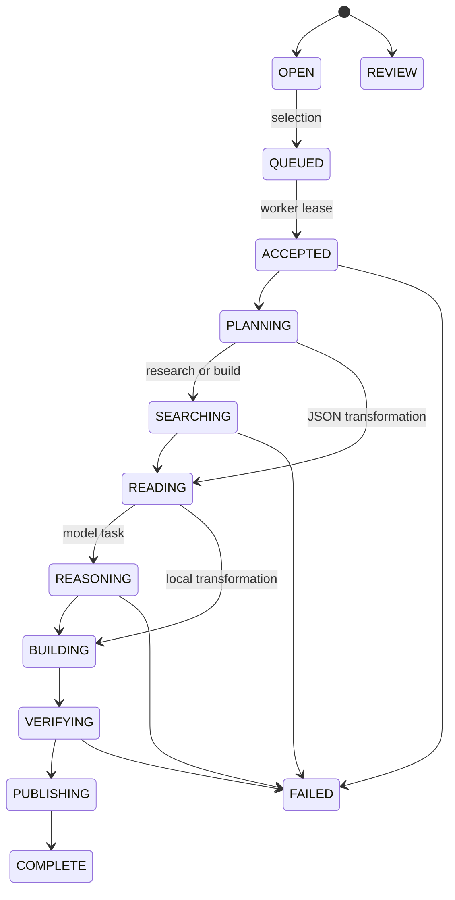

# Mission engine

A command becomes an object with a finite budget. It does not become authority to run arbitrary instructions.

Submission validates length, schema and operation ID, classifies permissions/feasibility, resolves the holder tier, checks quota and reserves CONTROL transactionally. Public commands enter OPEN or REVIEW; private eligible jobs enter QUEUED. Support allocations update aggregate score transactionally. Selection chooses highest support, then oldest submission, among feasible public commands.

Transitions write durable events before they appear in `/work`. SSE emits events, heartbeats and terminal state; the client deduplicates by event ID and retains API snapshot polling. There is no random terminal text. Machine service status is derived from active execution stages.

The worker acquires a database lease with a bounded attempt count. Policy limits steps to 12 and execution to 120 seconds; providers have independent shorter timeouts. Search permissions, model pricing preflight, cumulative settled costs and unknown-cost reservation constrain spend. Artifact publication reads back bytes and verifies SHA-256. Completion stores a receipt with its complete event chain, resource budget, usage IDs and artifact hashes. Failed work also gets a receipt.

Demo requests run short jobs through platform execution context. Live submissions only enqueue; `worker/run.ts` calls the authenticated tick endpoint and awaits execution. Each tick runs an existing queued job or selects the next public command. Do not run overlapping unconstrained worker replicas.

Receipts are immutable. The retry endpoint refuses to mutate an old failed execution; after reconciling possibly billed calls, submit a new command with a fresh budget/operation ID. Maximum attempts bound lease acquisition, not automatic repeated paid inference. REVIEW requires operator intervention; there is no public moderation or arbitrary override endpoint.

Research produces a report; transformations parse JSON locally; small builds package an HTML field guide from their findings without executing generated code. Mock public world generation creates a new manifest/URL backed by the curated demonstration dataset. Autonomous renderer generation and unrestricted website deployment are intentionally outside the shipped executor.

Operational recovery: inspect expired leases and provider usage, seal the interrupted mission as failed, then submit a new command. The current worker does not automatically replay expired paid work. Schedule reconciliation/cleanup and monitoring before enabling sustained production traffic.

## On-demand execution and daily reservations

`POST /api/missions/:id/execute` requires a signed-in eligible holder and the usual private-job ownership check. It awaits execution within the request; a database lease prevents duplicate dispatch. The Work UI dispatches queued work once per page session. Continuous servicing is the separate worker’s responsibility. No automatic retry of uncertain paid calls is enabled.

Before paid tools run, the engine atomically reserves the mission ceiling in `compute_reservations`. The daily sum includes actual settled cost or the full reserved ceiling for unknown settlement. This prevents concurrent jobs from overcommitting the configured daily cap. Local transformations reserve zero. Paid transport/accepted-call uncertainty marks receipts unsettled and keeps the reservation. Reservations use UTC daily periods.

## Playable build artifacts
Build jobs validate a bounded world recipe before acceptance. The worker produces recipe/report JSON and atomically registers its world manifest with mission completion. Public builds enter selection; private builds remain owner-only. See world-system.md.
