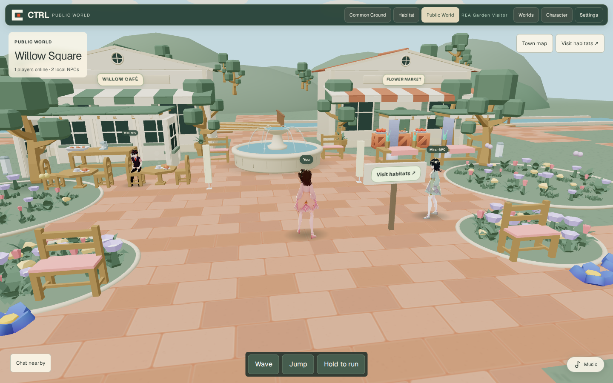
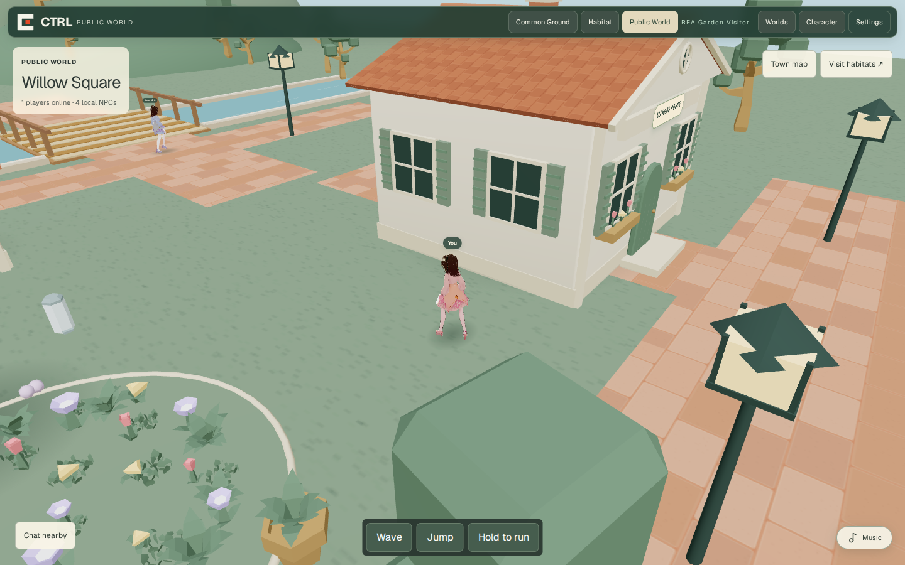

# Public World — complete asset/environment polish pass

Renderer tested and captured: **`628302676996efba889c9abfcf22a4c3137e0589`**, following implementation `997534f4ab34bfef564d88d0df108370562ff537`. Branch `feat/public-world-garden-life`, follow-up in PR #29. The evidence-only commit adds this report/PNGs; its SHA is recorded in the PR. No production deployment, main merge, paid purchase or protected game extraction.

## Reference selection and licensing

The user's earlier references included Kenney, OpenGameArt, itch.io and Three.js Assets Studio. Official Kenney [Nature Kit](https://kenney.nl/assets/nature-kit), [Furniture Kit](https://kenney.nl/assets/furniture-kit) and [Food Kit](https://kenney.nl/assets/food-kit) pages were checked; these publish CC0. The [OpenGameArt Nature Kit listing](https://opengameart.org/content/nature-kit) was also inspected. The official [Three.js Assets license](https://threejsassets.com/license) distinguishes embedded project use from redistribution of standalone asset files; no assets were purchased/downloaded from that service or assumed to be CC0.

CTRL already contains 991 allowlisted Kenney GLBs with pack licenses, source URLs and archive hashes in `public/plaza/build-kit/provenance.json`. The selected models are reused from that **existing verified local library**, not guessed download URLs or newly generated AI art. `town-asset-manifest.ts` lists the **19 curated models, 221,100 bytes combined**. Each is below 50 KB; no dependency/lockfile or binary-model edit was needed.

| Licensed selection | Use |
| --- | --- |
| Nature: `tree_detailed`, `plant_bushDetailed`, `grass_leafsLarge` | Branched trees, authored bushes and leaf groundcover replace simple sphere canopies/shrubs. Repeated meshes are instanced by primitive/material. |
| Nature: `flower_redA`, `flower_yellowB`, `flower_purpleC`, `pot_small` | Actual stem/petal meshes, mixed deterministic planting, window-box flowers and potted foliage; uniform blob daisies removed. |
| Furniture: `chairRounded`, `benchCushion`, `tableRound`, `trashcan` | Rounded café chairs, padded benches, picnic seating and utility props. Render aliases stay inside original seat footprints. |
| Food: `plate`, `croissant`, `cup-tea`, `cup-saucer`, `plate-rectangle`, `apple`, `tomato` | Café tableware, pastries, picnic place settings and a stocked market display. |
| Platformer: `crate` | Small produce display crates, with matching shared solid footprints. |

Existing source-pack licenses remain bundled. The VRoid/avatar binaries and anatomy are unchanged. Original geometry/code supplies the architecture, fountain, boats, wood/roof/paving textures and steam; no Heartopia model, texture, shader or code was copied.

## Implemented scene-wide polish

- **Plants/materials:** several Nature Kit GLBs export metalness=1. Town-only material clones set diffuse metalness=0 and adopt CTRL foliage/wood colors; cached materials used by Common Ground/Habitat remain unchanged. Flower/leaf/shrub placement excludes existing café/bench seating zones.
- **All six neighborhood houses:** closed gable surfaces, smaller roof-tile pattern, ridge caps, attic windows, arched doors/handles, cream plinths, shutter louvers, flower boxes and windows on both side walls. Blank side façades were caught during a real district walk and corrected. White frames/boards/louvers are merged by material to add detail without one draw call per slat.
- **Both shops and café annex:** closed tiled roofs, round attic glazing, framed dark-green storefront windows, striped valances, plinths, native café pergola beams, warmer corrected furniture, tableware and pastries. Existing IDs, interaction behaviors and primary building footprints remain intact.
- **Landmark/waterfront:** sculpted lathe fountain replaces the pawn-like centerpiece; thin arcing water jets and moving droplets. Boats have shaped beveled hulls, decks, seat planks, cloth sails and existing low-cost bobbing. Bridge boards gain an original wood-grain texture; rails/banks/bridge dimensions are unchanged.
- **Grounding/surfaces:** all paving uses one world UV origin and the Common Ground 1.2×0.8 tile proportions; mismatched intersection scales removed. Lawn noise no longer forms diagonal barcode stripes. Terrain sampling now intersects the actual rendered low-poly hill triangles: analytic ellipsoid sampling had put some trunks **0.764 m above** the mesh. A regression locks the observed problematic location.
- **Movement:** new picnic furniture, pots and market crates share their exact positions/footprints through `town-prop-layout.ts` with `public-world-geography.ts`. Client and signed server consume the same movement rules. NPC district paths, both bridges and existing signed route tests remain valid. Decorative soft plants are not new hard blockers.

The existing compact HUD, permission-scoped directory, automatic multiplayer entry, real player counts, local-NPC marking, speech/wave, wallet signing, home saves and ACL revocation are preserved. **Common Ground was not redesigned; personal Habitat keeps its original models/materials/camera.**

## Actual runtime/render evidence

REA **6.4.0**, supported passive loopback CDP workflow, owned CTRL origin `http://127.0.0.1:3188`. Observation **2026-10-13T08:48:51.301Z**, clean renderer SHA above, zero page errors. Playwright owned the browser/database and used the real synthetic-wallet nonce/signature API. No agent configuration, production credentials or third-party protected binaries were modified/inspected.

| Capture / observation | REA evidence |
| --- | --- |
| Target discovery | `ev_fc2b049c0cc6ccfaceba8d9036df144dba95c113a619d21353130d6249154a88` |
| Page/runtime inspection | `ev_f01d1c163dfab6703de8a7f72bfab4f8ca66fc57c4aa9a9715f68ff526aa18fb` |
| Desktop, default light profile | `ev_0f793259cc4f4605fdea94f655b9fabd778488ba2cbabb69a5dd93468956f81b` |
| Mobile-sized viewport | `ev_24bb9486fcb428971f099798d813fbc7d9e2985392b8edc320671f34211b7712` |
| Desktop profile, elevated camera via real drag | `ev_7a9c3fa6cb39bab35214f845454342f5c3b7a52255cd608a26d2c7192235324b` |
| District reached by real keyboard movement | `ev_1884932b913c7d0c7a0ae68c932843795048e43808f786466e26fc6ebfc59883` |

The district screenshot was reached using held WASD keys, with accepted signed server position **x=17.015, z=3.547**. No pose refs, auth endpoints or presence routes were mocked/teleported. High-detail shots use the actual Graphics → Desktop option and camera drag, not a different renderer or generated concept image. REA mobile capture resizes the signed viewport; the separate mobile browser test cold-starts touch emulation. All screenshots are unretouched and preserve the approved female VRoid with normal randomized appearance.

| View | Real PNG |
| --- | --- |
| Desktop 1440×900, default light profile | [PNG](asset-polish-evidence/desktop.png) |
| Mobile-sized 390×844, light profile | [PNG](asset-polish-evidence/mobile.png) |
| Desktop detail, Graphics → Desktop and elevated camera | [PNG](asset-polish-evidence/desktop-detail.png) |
| Residential district, Graphics → Desktop, signed walking | [PNG](asset-polish-evidence/district.png) |





Reproduce:

```bash
pnpm build:next
CTRL_CHROMIUM_PATH=/path/to/chromium node --import tsx scripts/qa/rea-town-observe.ts outputs/rea-full-assets-reviewed --details
CTRL_CHROMIUM_PATH=/path/to/chromium CTRL_QA_PRODUCTION=1 pnpm exec playwright test --config playwright.public-world.config.ts
```

Raw REA evidence stays in ignored outputs. The published report includes only evidence IDs, sanitized positions and game PNGs, not sessions/cookies/wallet addresses.

## Verification and limits

| Gate | Result |
| --- | --- |
| Full unit/API/wallet/ACL/presence suites | **200/200 PASS**, 36 files |
| New asset polish regressions | **7/7 PASS**: local CC0/budgets, alias footprints, material immutability, shared UVs, planting clearances, prop solids, exact terrain grounding |
| Public World regressions | **13/13 PASS**; bridge rails/banks, NPC paths, houses, signed round trip and private-home boundary retained |
| Palette continuity | **2/2 PASS** |
| Typecheck + required scoped ESLint including all new modules | PASS, no lint warnings |
| Production Next build | PASS; existing ox/viem dynamic-dependency warning only |
| Shipped build-kit integrity | PASS: **991 GLB / 991 WebP**, 13.10 MiB kit |
| Production desktop/mobile browser suite | **4/4 PASS**, no skips/retries, about 2.4 minutes |

Browser tests exercise signed keyboard/touch movement, orbit/pinch, shader/black-tile gates, HUD occupancy, two-wallet speech/wave, permissioned and denied Habitat visits, ACL revocation, return navigation and unchanged profile. REA was closed before this browser/performance run.

Desktop: 137 quantized colors / 126 non-sky, near-black central samples 0.35%, HUD occupancy 9.52%. Mobile: 70 / 66, near-black 1.26%, HUD 22.83%. No overflow or uncaught page errors.

Mobile **4× CPU throttling + SwiftShader** sampled 22 frames over roughly three seconds: p50 **149.9 ms**, p95 **183.3 ms**. This is constrained headless emulation, not physical-device FPS or a controlled statistical comparison. Actual iPhone/Android hardware GPU/thermal profiling remains a release gate. High quality adds shadows/NPCs; light profile still omits the shadow pass. The narrow mobile frontal viewport reveals less of the side planting. This complete polish pass remains stylized original CTRL art, not a claim of Heartopia's bespoke production assets/content quality.

Review/integrate in PR order, run combined release CI at the final merge SHA, and deploy only through an explicitly authorized release workflow. No production/live-release claim is made.
