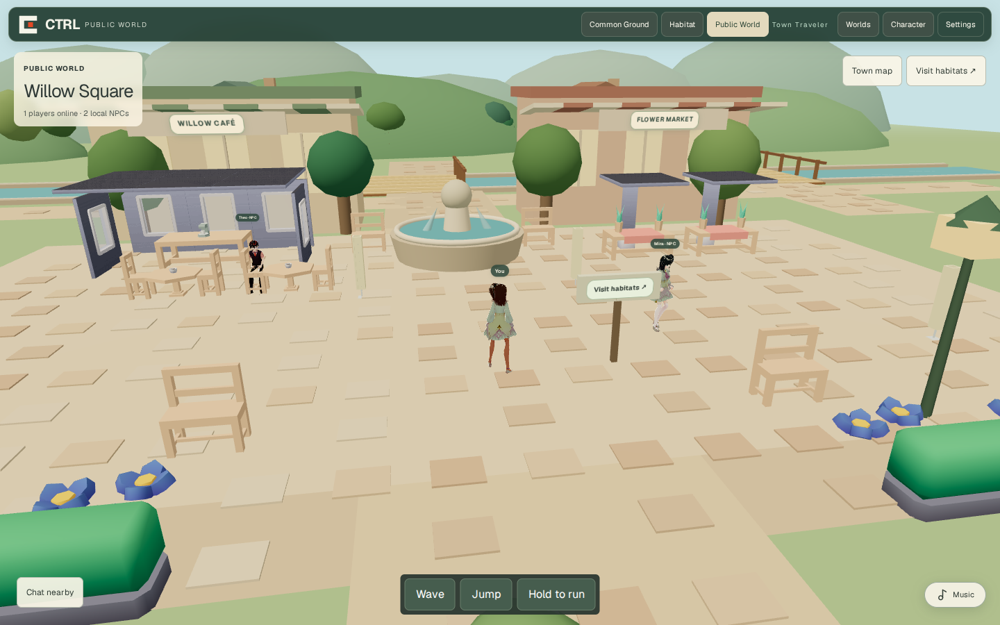
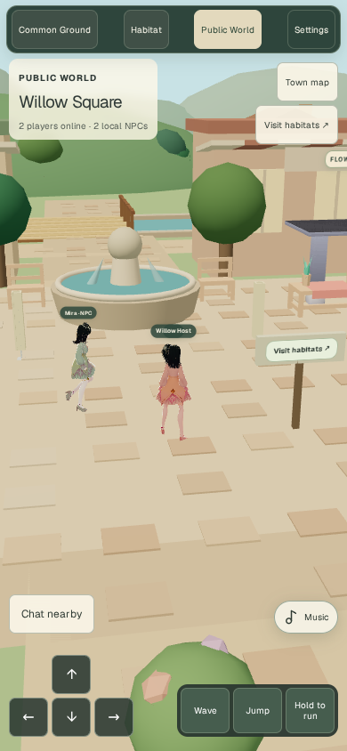

# REA-assisted Public World implementation evidence

## Target, permission and version

- Repository: `snidova1/ctrl-playground`; execution branch: `feat/rea-world-polish-execution`.
- Exact handoff: `5da6dc6fcc364df35242d63b4cdff1a64a160426`; target PR base: `feat/public-world-real-neighborhood` at `57d0f245ad5cf835e2977883cff44d906ec51435`.
- Runtime implementation: `d51a8950b82980e0315db254ae955f1993cd31b2` (preceded by scenery/HUD commit `9ec82844f8ec62bfd6d569b695d6fc80732d8562`). The later evidence commit only adds this report and PNGs; its exact SHA is recorded in the PR and CI checkout.
- Observation: production browser suite started **2026-10-13T04:58:04.140Z**, completed in 136.91 seconds. Screenshots below were captured from this implementation, not generated artwork.
- Permission basis: the repository owner explicitly authorized inspection, implementation, local signed-wallet tests and a PR. Inspection was restricted to owned CTRL source, locally built JavaScript, the isolated local database and synthetic signing wallets. No production credentials, third-party game binaries, Heartopia code/assets, contracts or paid providers were used.
- Common Ground's landing design, guest randomization and persistence boundary are unchanged. Personal Habitat geometry, ownership, saves and ACLs are unchanged. Shared modules contain Public-World-only guards.

## REA execution and limits

Node **24.19.0**, pinned pnpm **11.25.0**, actual npm `rea-agents` release **6.4.0**. Handoff preflight and frozen-lockfile installation passed. Reviewed upstream `morluto/rea` README and actual CLI help.

Executed `doctor --client codex --json` and `setup --client codex --dry-run --json`. Doctor found the local MCP registration/skill absent; the dry run proposed registering `npx -y rea-agents@6.4.0 mcp` and installing its skill. **No agent configuration was modified or restart attempted.** Native decompilers were not needed or installed.

Executed the actual CLI on `.next-node/static/chunks` after the production build:

```bash
npx -y rea-agents@6.4.0 analyze-javascript-application "$PWD/.next-node/static/chunks" --json --analysis-timeout-ms 120000
```

REA inventoried **122 JavaScript source files** and returned a partial **240-node** artifact graph. Its deeper source analyzer stopped with `capability_unavailable`: the sandbox's `ps -axo pid=,ppid=,pgid=,uid=,stat=,command=` failed process-ownership inspection (`fatal library error, lookup self`). This safeguard was **not bypassed**. REA did not prove runtime execution or diagnose the visual defects independently.

- Evidence key: `ev_eee8f652c312659f86ada4f1c7423aa36d55b51c90bd8e8d1054f6c8d4770346`.
- Built-bundle SHA-256: `7995b844fb25dfcf96f87b09e2af38391167ec91f484a1c49a58d1a0632d1228`.
- Raw evidence remains in ignored `outputs/rea-final-bundle-evidence.json`; it is not published with sessions, cookies or wallet material.
- Runtime evidence is the **real Playwright/Chromium software-WebGL fallback**, source inspection and signed API regressions permitted by the handoff. No claim of complete REA semantic reconstruction is made.

## Observed findings → implemented fixes

| Evidence / observed behavior | Implementation | Executable proof |
| --- | --- | --- |
| Baseline PNGs show white imported floor sheets above the authored plaza, very dark oak geometry and a block obscuring the fountain water. | `stage.tsx` suppresses only redundant system-town representations; instanced original trees and the authored fountain replace them. Persistent object IDs, interaction furniture and Habitat rendering remain intact. | Real rendered pixel diversity/near-black gates; original asset and Habitat tests. |
| Source bridge clearances exceeded the visible rails; waterbank checks only protected the avatar's center. Continuous quay walls crossed the bridge approaches. | `public-world-geography.ts` shares deck/rail measurements and avatar radius with scenery. Quays now have matching openings. Fountain radius is blocked. | Both bridges, shoulders/rails, approach edges, banks and fountain tests; signed server round trip. |
| Object collision and geography were applied as separate sliding passes, risking contradictory final positions. | `types.ts` checks Public World geography and object obstacles within the same swept step. The existing server presence handler consumes this identical function. | Signed round trip across both bridges and plaza; six building footprints; unchanged personal-home bounds. |
| Baseline controller disabled camera obstacle checks when a custom navigator was supplied. | `town-camera.ts` intersects roof/awning volumes and shortens the town camera ray, with quicker obstruction recovery. Town mouse orbit/wheel and two-finger pinch use bounded distances. | Pure ray intersection tests; actual keyboard/touch movement accepted by server; desktop orbit/wheel and mobile pinch assertions. |
| Baseline storefront/destination labels floated independently of the meshes; house roof plates had open/inverted seams. | Closed gable roofs, striped awnings, attached signs, original round foliage and rolling hill silhouettes. Two boats bob and canal ripples move subtly. Existing six homes, stores, roads, bridges and seating remain. | Actual desktop/mobile PNG inspection and WebGL exception gates. |
| NPC activity was continuous small circles near spawn, with limited spatial variety. | `town-residents.ts` defines deterministic district routes, rest/wave phases and a seated café resident. Two local NPCs on light quality, four on desktop quality. NPCs never enter server presence/player totals. | Route walkability/determinism/rest tests; separate `players online` and `local NPCs` UI. |
| Baseline mobile chat overlapped the movement area. Directory access relied on a floating scene button; traveling from Public World retained its URL. | Town-only collapsible chat, 44px controls, compact title, live town map and persistent permission-scoped directory button. A successful home visit updates the destination/URL. Chat/wave immediately request the existing sequenced presence sync. | HUD occupancy/overflow checks; two signed browsers chat/wave, permitted/denied private visits, revocation, own-home return and unchanged character/profile. |
| Software WebGL with two active views delayed transient bubble assertions. Initial tests also used short fixed-duration movement and development recompilation. | Light-quality Public World omits the expensive shadow pass; other destinations retain shadows. Social QA uses independent browser processes, waits for real avatar readiness, and tests the production build. Movement waits for an observed signed pose while input is held. | Final production suite **4/4 passed**, without retries, skipped tests, extended speech lifetime or mocked authorization routes. |

The suspected effects of GPU contention and development recompilation were hypotheses informed by traces; they are not measurements of a physical phone. The actual observations are delayed browser assertions, passing server responses, the final timings below and the passing production scenarios.

## Actual screenshots

Desktop before and after are 1440×900. The handoff mobile baseline used the stock iPhone 13 **390×664 CSS viewport / DPR 3**; final mobile QA explicitly uses **390×844 CSS pixels** and captures at CSS scale. These are different viewport heights, not a pixel-aligned performance comparison. No screenshots were retouched.

| | Desktop | Mobile |
| --- | --- | --- |
| Handoff before | [PNG](screenshots/willow-before-desktop.png) | [PNG](screenshots/willow-before-mobile.png) |
| Implemented after | [PNG](screenshots/willow-after-desktop.png) | [PNG](screenshots/willow-after-mobile.png) |





QA reviewed both final PNGs: a visible avatar, plaza/fountain, café/market, bridge/waterfront, hills/foliage, readable controls, no black instancing tiles and no duplicate global masthead. Appearance is intentionally randomized; recently connected test players can remain visible until normal presence expiry. This is original CTRL cozy-world polish, **not a claim of Heartopia's production art/content quality**.

## Proof gates and metrics

| Gate | Result |
| --- | --- |
| `node scripts/rea-world-preflight.mjs` | PASS at the clean implementation checkout |
| `pnpm install --frozen-lockfile` | PASS; no dependency/lockfile edits |
| `pnpm exec vitest run tests/unit/public-world.test.ts` | **13/13 PASS** |
| `pnpm test` | **191/191 PASS, 34 files**; original wallet/ACL/presence suites retained |
| `pnpm typecheck` | PASS |
| Required scoped ESLint plus new town modules/browser tests | PASS |
| `pnpm build:next` | PASS; existing `ox/viem` dynamic-dependency warning only |
| Production Playwright desktop/mobile | **4/4 PASS**, 0 skips/retries/flaky results |

Local browser command (the override only selects the installed Chromium executable):

```bash
CTRL_QA_PRODUCTION=1 CTRL_CHROMIUM_PATH=/path/to/chromium \
  pnpm exec playwright test --config playwright.public-world.config.ts
```

CI builds first, installs official Chromium, uses this production mode and uploads `test-results/`; it does not deploy. Local browser installation's CDN archive was invalid in this sandbox, so local QA used npm-distributed Chromium **153.0.8010.0** with SwiftShader. CI is a separate release gate; local results are not presented as completed GitHub Actions results.

| Final rendered-pixel / layout metric | Desktop | Mobile |
| --- | --- | --- |
| Quantized colors | 153 | 77 |
| Non-sky colors | 106 | 65 |
| Near-black central samples | 0.47% | 0% |
| Sampled HUD occupancy | 9.52% | 22.83% |
| Off-screen HUD / uncaught page errors | None | None |

Light-quality mobile emulation with **4× CPU throttling + software WebGL** sampled 25 animation frames over approximately three seconds: **p50 116.7 ms, p95 216.7 ms**. This is a constrained headless observation, **not physical-device FPS**. It confirms the sandbox is slow; it does not establish a mobile shipping performance budget. Real iPhone/Android hardware, WalletConnect pairing, thermal behavior and hardware-GPU frame pacing remain unverified. High quality retains shadows and additional NPCs and needs device profiling.

## Release-owner handoff

Review this PR against `feat/public-world-real-neighborhood`, run the full combined CI at its exact merge SHA, then use the authorized staging/Sites workflow to deploy the tested SHA and smoke-test with two real signing wallets. **No merge to main, production deployment, onchain action or live-release claim was made by this execution.**
