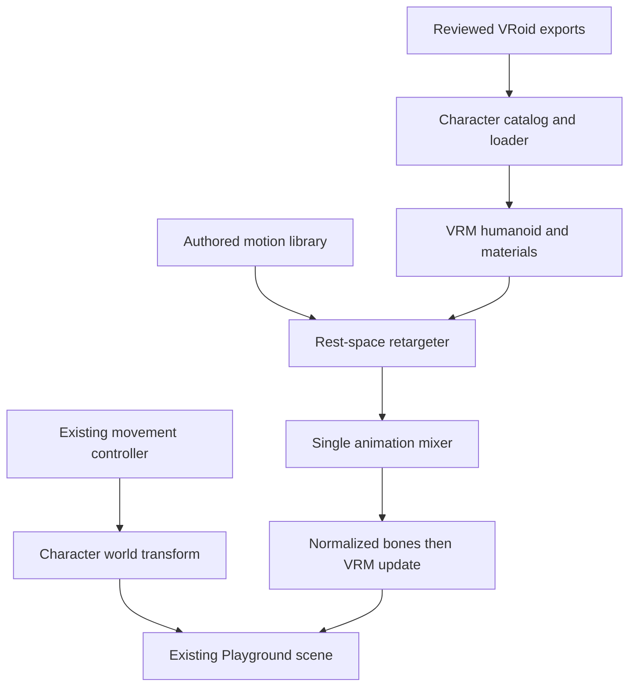

# VRoid → VRM → CTRL Playground

Status: isolated local candidate. **Not deployed; default MIO unchanged.** The preview is a technical and visual evaluation of VRoid as the foundation, not an approved original CTRL character design.

## Existing systems reused

| Existing system | Integration |
| --- | --- |
| `scene.tsx` Controller | Same WASD/arrow/touch input, collision and orbit camera. Preview-only walking/running speeds and jump trajectory. |
| `use-plaza.ts` | Same guest session, shared state and pose synchronization. Touch input now preserves optional run/jump fields. |
| Objects/workshop/bag | Same build, place, use, sit, drink, persist and remove actions. |
| `avatar.tsx`, `mio.glb` | Unmodified; still the public default, remote-player renderer and load-error fallback. |
| Backend, wallet, holder threshold, Orbio | No changes. No credentials needed for the free preview. |

`Pose` and the multiplayer API remain unchanged. Preview running/jumping and interaction animation are local; remote visitors continue to see MIO with the existing position/walk synchronization. This work does not claim full networked avatar/loadout synchronization.

## Authoring pipeline

1. Design the character in **VRoid Studio**. Keep its editable `.vroid` source and licensed textures/custom items separately from runtime exports.
2. Export a self-contained `.vrm`, preferably VRM 1.0. Review the model's humanoid T-pose, material alpha, expression bindings, clothing fit and license metadata. VRM 0.x is also supported.
3. Produce desktop/mobile exports. The current `optimize-vrm.py` resizes embedded images while retaining every indexed rig/morph/metadata reference. Do not run a generic mesh optimizer that silently strips VRM extensions.
4. Add reviewed local URLs and provenance to `characters/catalog.ts`. No arbitrary URL or public upload is accepted.
5. Load with `GLTFLoader` + `VRMLoaderPlugin`, normalize legacy orientation, optimize redundant vertices/morphs/skeletons, and retarget authored motions to normalized humanoid bones.
6. Test in `/character-preview` before any approved default-character switch.

VRoid Studio is the desktop authoring tool; it is not embedded inside the website and does not generate gameplay animations. This environment uses a complete licensed VRoid sample export to test the pipeline; a new editable CTRL `.vroid` source has not been authored here.

## Runtime architecture



- `catalog.ts`: asset profiles, height, identity/provenance and future loadout descriptors.
- `loader.ts`: bounded local fetch, GLB/VRM validation, optimization, secondary motion, and per-instance disposal.
- `retarget.ts`: rest-space quaternion mapping from the free Quaternius skeleton to standard humanoid names. Source animation tracks are never modified.
- `animation.ts`: one mixer and explicit idle/walk/run/jump-start/jump-loop/land/sit-down/seated/interact/celebrate states.
- `vrm-avatar.tsx`: local rendering, root transform interpolation, abortable loading, failure fallback and retry.

The controller owns x/z translation and jump height. Animation root-motion x/z are removed. Sitting retains its authored local pelvis offset. Bone rotations are converted using parent rest orientation and inverse source bone world-rest orientation; quaternion normalization and sign continuity prevent long-path interpolation. VRM 0's orientation/sign convention is handled separately from VRM 1.

Only the mixer writes normalized humanoid bones. `vrm.update` then transfers them to the raw skinning rig, applies expressions and updates permitted secondary hair motion. There is no simultaneous manual head sway, physics torso rotation or second skeleton writer. Idle is applied before first presentation, avoiding a T-pose flash. Existing camera behavior is unchanged, including a grounded camera during jumps.

Simulation runs in bounded 1/60-second steps, at most three per frame. Long hidden-tab deltas reset springs and cannot cause a catch-up explosion. The existing scene pauses rendering while hidden. Sitting and jumps take priority over locomotion; clips crossfade over 160 ms. First presentation resets secondary motion after placing the root in world space.

## Preview and controls

```sh
pnpm install
cp .env.example .env.local
pnpm db:local
CTRL_CHARACTER_PREVIEW=1 pnpm dev:next
# http://localhost:3000/character-preview
```

`CTRL_CHARACTER_PREVIEW=0` is the checked-in default. `/character-preview` returns 404 unless enabled. The home page still instantiates MIO even when this flag is enabled; no default character switch happens implicitly.

Desktop: WASD/arrows walk, Shift run, Space jump, drag/scroll the existing camera, E interact. Mobile: existing joystick, hold-to-run, jump button and existing object action button. Settings can switch between full and light rendering. Preview annotations appear only after entry and close while drawers are open.

## Visual candidate and budgets

Victoria Rubin / β Ver AvatarSample_4 is a complete CC0 VRoid reference character with textured face, skinned clothes/hair, humanoid bones and blink expressions. It is not MIO and has not been approved as the product's final visual identity. [Provenance and the embedded-license discrepancy](../public/plaza/licenses/vroid-victoria.md).

| Profile | Asset size | Maximum embedded texture edge | Secondary motion | Outlines |
| --- | ---: | ---: | --- | --- |
| Desktop | 7,957,408 bytes | 1024 px | Damped hair; decorative torso/sleeve/skirt springs disabled | Original MToon |
| Mobile | 5,556,068 bytes | 512 px | Disabled, preserving skinning | Outline draw groups omitted |
| Shared motions | 1,697,720 bytes | None | Ten animation-only clips | None |

The VRM renderer is a lazy module (192,129 bytes / 48,499 bytes gzip in the verified build); default Playground visits do not request VRM files. One owned VRM instance per local preview avoids cross-avatar bone mutation. On unmount/quality change, animation actions, skeleton textures, geometry, material and texture resources are disposed. No large textures are fetched from a third-party CDN at runtime. The existing scene DPR cap and quality settings are reused.

These are optimized preview assets, not a claim of 60 FPS on every phone. Rendering QA uses Chromium software WebGL and a mobile viewport, not a physical iPhone/Safari GPU benchmark. The detailed sample still has many materials; final original-character art should use an atlas and simpler hair topology.

## Future character customization

`CharacterDefinition` separates runtime assets and proportional height from identity and appearance descriptors. `CharacterLoadout` stores a versioned character/variant reference and reviewed accessory anchors. Changing a reviewed definition does not require replacing movement, camera, actions or the world.

- Hair and outfits: start with complete, fitted VRoid export variants. Swapping arbitrary skinned meshes between exports is not safe; bone names alone do not guarantee matching bind matrices or clothing fit.
- Body proportions: author in VRoid, re-export, rerun height/hips retarget calibration and seat/ground-contact checks. This is not a fake runtime slider that merely stretches the rendered mesh.
- Accessories: attach reviewed rigid objects to raw humanoid bone anchors after normalization, with per-item offsets. Skinned clothes need their own fitted rig pipeline.
- Expressions: use VRM expression names; automatic blink is implemented. Do not add another competing head/look-at controller.
- Persistence/networking: add validated loadout IDs and server allowlists only when character creation is actually introduced. User upload moderation/storage and replicated run/jump/interaction states are separate future work, not enabled by this candidate.

## Verification

```sh
pnpm test
pnpm typecheck
pnpm lint
pnpm build
CTRL_TEST_CHROMIUM=/path/to/chromium node scripts/character/inspect-vrm.mjs
CTRL_CHARACTER_PREVIEW=1 CTRL_TEST_CHROMIUM=/path/to/chromium node scripts/test-plaza-render.mjs
CTRL_TEST_CHROMIUM=/path/to/chromium node scripts/test-plaza-render.mjs
```

Unit checks load actual three-vrm synthetic VRM 0 and 1 humanoids, retarget the actual motion library, verify source immutability/unit quaternions/root drift removal, cover state priority and bounded resume/jump behavior, and reject external references/malformed containers. The detailed visible sample is VRM 0; the synthetic VRM 1 check is not a claim that every third-party VRM 1 avatar has been visually approved.

Browser fixtures use real render components, assets and API handlers with an isolated SQLite database; no paid provider calls or live-user data. They check desktop/mobile entry, movement, workshop/place/use/seating/bag, persistence, sharing, deletion, layout and runtime errors. A deterministic fixture spawn is used for dispenser proximity after separately exercising movement, avoiding an FPS-dependent navigation test.

The isolated renderer measured 86 draw calls / 42,630 triangles for the full profile and 78 calls / 29,802 triangles for light rendering (including its single floor plane, without courtyard shadow passes). Cleanup returned to one floor geometry and zero textures. These are actual renderer counters, not an FPS benchmark. [Recorded render report](previews/vrm-render-report.json) and [motion study](previews/vrm-motion-study.mp4).

The isolated renderer measures torso/head transform continuity over six seconds of each loop and checks cleanup. Reports and actual screenshots/video accompany this source. Retargeted authored running intentionally has larger upper-body motion than idle; zero movement is not a stability target. Any future avatar/clip must pass this gate and visual checks again.

## Approval boundary

No deployment and no overwrite of `avatar.tsx` or `mio.glb` is part of this task. Preview success does not authorize publication. Only after the user approves a tested replacement should a separate change switch the default, extend multiplayer identity if required, and publish. Character creation UI is not implemented yet.

## Primary references reviewed

- [pixiv three-vrm](https://github.com/pixiv/three-vrm), pinned 3.5.5; existing Three.js 0.180.0 retained.
- [Official rest-space animation example](https://github.com/pixiv/three-vrm/blob/release/packages/three-vrm/examples/humanoidAnimation/loadMixamoAnimation.js). Same conversion approach, adapted to the project's Quaternius skeleton; no Mixamo clips used.
- [VRM features and version differences](https://vrm.dev/en/vrm/vrm_features/).
- [Model-specific VRoid sample terms](https://vroid.pixiv.help/hc/en-us/articles/360014900233).
- [Quaternius Universal Animation Library](https://quaternius.itch.io/universal-animation-library), free Standard pack, CC0. The current pack distinguishes free Standard from paid Pro/Source.

### Recorded result for this candidate

- 71 unit/API tests passed, including six new VRM tests.
- TypeScript and ESLint passed. Production Worker build passed; its existing Three.js chunk-size warning remains (not a build failure).
- Detailed VRM desktop and mobile Playground workflows were exercised. The latest isolated boundary run also includes the actual site Shell, switches both graphic profiles, deliberately fails the desktop asset fetch, renders MIO as fallback, and successfully retries. [Boundary report](previews/vrm-boundary-report.json).
- The unchanged default MIO Playground passed the complete desktop/mobile regression workflow and requested **zero** VRM asset URLs. [Regression report](previews/mio-regression-report.json).
- The browser's unauthenticated session probe intentionally receives HTTP 401; the fallback test intentionally receives HTTP 503. No uncaught JavaScript errors occurred in passing runs.
- Model/animation inspection passes for both quality profiles, and disposed model texture count returns to zero. Real-device Safari testing and artistic approval remain outstanding.
